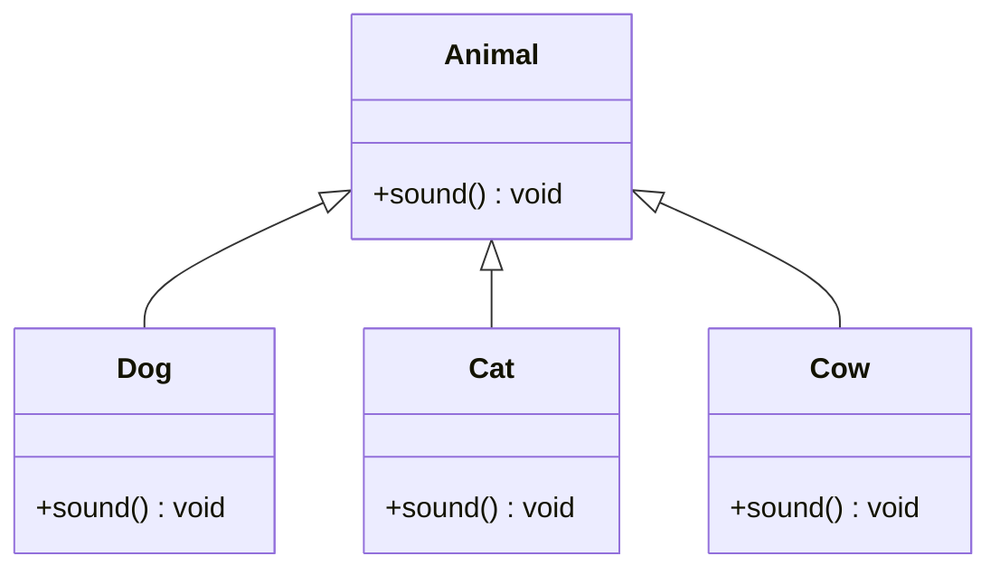

# Java Internship - Runtime Polymorphism Demo

A clear Java project demonstrating core Object-Oriented Programming (OOP) concepts, specifically **Inheritance**, **Method Overriding**, and **Runtime Polymorphism (Dynamic Method Dispatch)**.

---

## 📌 Overview

This project showcases how a common parent reference can point to various subclass objects at runtime and invoke overridden methods dynamically based on the actual object type.

### Key Concepts Demonstrated

- **Inheritance**: Subclasses (`Dog`, `Cat`, `Cow`) inherit properties and behavior from the superclass (`Animal`).
- **Method Overriding**: Each subclass provides its own specific implementation of the `sound()` method.
- **Dynamic Method Dispatch**: The method call `animal.sound()` is resolved at runtime based on the object assigned to the `animal` reference.

---

## 🏛️ Class Hierarchy



---

## 📁 Project Structure

```text
java intership/
├── Main.java        # Main source file containing Animal hierarchy and driver code
└── README.md        # Project documentation
```

---

## 🚀 How to Compile and Run

Ensure you have the Java Development Kit (JDK) installed (version 8 or higher).

### 1. Compile the Source Code

```bash
javac Main.java
```

### 2. Execute the Application

```bash
java Main
```

---

## 💻 Expected Output

```text
Dog barks: Woof Woof!
Cat meows: Meow Meow!
Cow moos: Moo Moo!
```

---

## 📝 Code Explanation

```java
// Common parent reference
Animal animal;

// Refers to a Dog instance; calls Dog's overridden sound()
animal = new Dog();
animal.sound();

// Refers to a Cat instance; calls Cat's overridden sound()
animal = new Cat();
animal.sound();

// Refers to a Cow instance; calls Cow's overridden sound()
animal = new Cow();
animal.sound();
```
